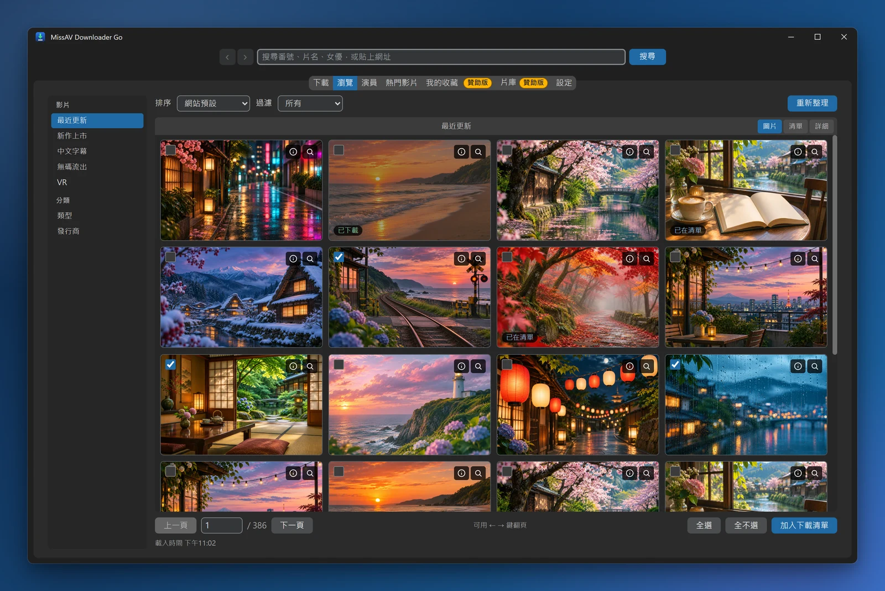
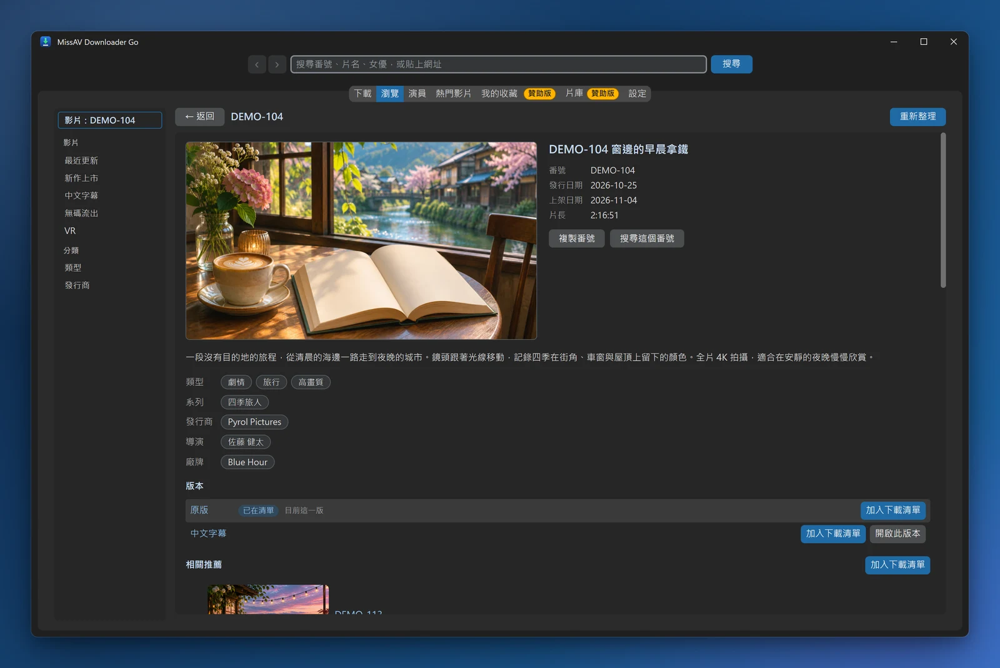
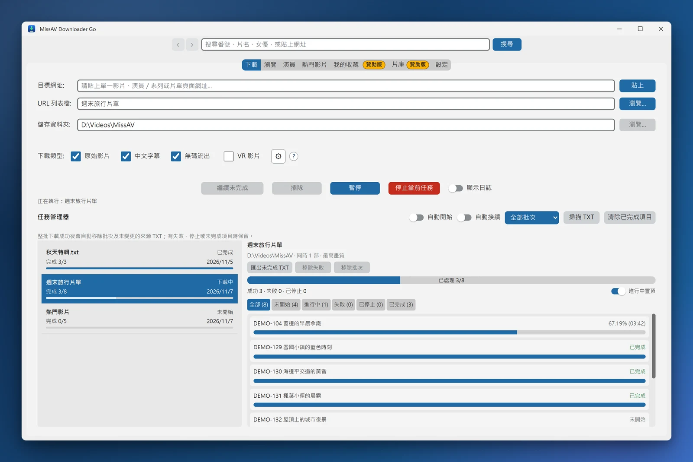

[English](README_en.md) | 繁體中文

# MissAV Downloader Go

**MissAV Downloader Go** 是一個專為多媒體串流、HLS (HTTP Live Streaming) 技術與自動化爬蟲分析所開發的學術研究工具。本專案旨在探討現代影音平台如何透過動態加密 JS 隱藏 m3u8 資源，以及如何在高併發環境下穩定下載串流分片。

> **v2.8.0 更新：新增「瀏覽」「演員」分頁與程式內的影片頁，任務管理器可以自動接續與插隊，網站本身壞掉的分片會被剪掉，之後的新版可以直接在程式裡更新。** 從舊版升級請看[升級說明](#從舊版升級)。

### [⬇️ 前往 Releases 下載最新版](../../releases/latest)

Windows 免安裝版，解壓即用。下載後請比對 [SHA-256 校驗碼](#檔案校驗)。

  

  
  

截圖中的番號、片名與封面皆為示意用的假資料。

---

## ✨ 核心研究功能

* **🖥️ 原生桌面介面**：以 Go + [Wails](https://wails.io/) 打造，透過系統內建的 WebView2 呈現，支援淺色/深色模式（可跟隨系統）。介面提供**繁體中文與 English**，預設跟隨系統語言，可在「設定」隨時切換，不必重開程式。重複開啟時會叫回原本的視窗，不會有兩個程式同時改同一份資料。
* **🕷️ 智慧爬蟲與篩選**
    * 貼上演員、系列或**片單**網址即自動抓取所有分頁影片，產生 URL 列表檔。片單會照原本的順序整份下載，列表檔以片單名稱命名。
    * **作品分類**：爬演員頁時可選「全部／單人／多人」作品。
    * **版本選擇**：可勾選要下載哪些版本（原始／中文字幕／無碼流出），並可選擇是否納入 VR。社群版會下載**所有勾選的版本**：同一番號同時有原始與中文字幕版時兩部都會下載，檔名分別標上 `[中文字幕]`、`[無碼流出]`，不會互相覆蓋。只想要原版的話，只勾「原始影片」即可。
    * 同一部影片的重複網址會自動去除。
* **🔥 熱門影片**：瀏覽今日／本週／本月熱門榜單（最多翻到第 100 頁），可放大檢視封面，勾選後直接加入下載清單。預設開啟哪個榜單可在「設定」指定。
* **🧭 瀏覽與影片頁**
    * 「**瀏覽**」分頁：搜尋、網站的各個分區、類型與發行商一覽，可排序、篩選、翻頁，勾選後加入下載清單。
    * 「**演員**」分頁：女優一覽、女優排行與每位女優的作品清單。熱門與作品清單都標出上架日期。
    * 頂端網址列可以搜尋、輸入番號或貼上網址；上一頁／下一頁支援滑鼠側鍵與 Alt+←／→。
    * **影片頁**：在程式裡看影片資料、切換同一番號的其他版本、看推薦影片；清單上的影片按右鍵有快捷選單。
    * 封面存在本機快取，清單捲動與回上一頁更快。
* **🛡️ 串流探測**：以獨立的連線元件模擬瀏覽器 TLS/HTTP2 指紋，研究現代反爬蟲機制下的資源探測行為。
* **📋 任務管理器**
    * 匯入的 TXT 會成為一個**批次**，每部影片的進度都存在本機，關掉程式再開也還在（預設不會自動開始下載）。
    * 失敗或停止的影片可以單獨重試；可匯出未完成的網址、清除完成記錄。
    * 啟動時自動掃描下載資料夾裡的 TXT 清單；同一份清單重新爬取後會併回原本的批次，已下載的影片不會重抓。
    * **暫停／繼續／停止**、**分片級續傳**（已下載的 `.ts` 分片會保留，中斷後不必從頭來過）、**雙層進度**與預估剩餘時間 (ETA)；清單會自動捲到正在下載的影片。
    * **自動開始**（閒著時匯入的影片直接開始下載）與**自動接續**（下載名額一空出來就接著跑下一批，不等上一批轉完檔）兩個開關，預設都關閉；**插隊**可以把某一批排到最前面。
    * 下載中也能貼網址加入下載清單。整批成功的批次會自動清掉，失敗、停止與未完成的影片留著重試。
* **🛠️ 自動化處理**
    * **無縫合併**：下載完成後由 FFmpeg（已內建可攜式版本）無損合併為 `.mp4`。分片依序直接串流給 FFmpeg，接縫不會出現空隙，片長與原始串流一致。
    * **斷線自動重試**：短暫斷線會自動重試，失敗的分片排到最後再補抓，連續 2 分鐘收不到任何資料才判定失敗。
    * **剪掉網站壞片**：網站上有些分片本身就是壞的（只有幾 KB、解不開）。下載時會先重抓一次，還是壞的就在合併後剪掉，影片在那裡直接接到下一段，不會停在解不開的畫面上。
    * **完整檔名**：檔名使用影片頁面上的完整標題，過長時自動截短；轉檔完成才寫入正式檔名，中途停止不會留下壞檔。
    * **邊轉檔邊下載**：上一部還在轉檔時，下一部已經開始下載。
    * **暫存清理**：每部影片轉檔完成後立即刪除它的暫存分片；未完成的分片會保留以便續傳，不需要時可在「設定」一鍵清除。
* **🧹 一鍵清除紀錄**：「設定 → 隱私」可以勾選清掉網址列的搜尋紀錄與上次停的頁面、封面快取、已完成的下載紀錄，以及內嵌瀏覽器的快取（下次開啟程式時清除）。

---

## 🔑 贊助版功能

上面列的功能，社群版**全部都能用**。贊助版是提供給**贊助者**的版本，在那之上多了下面這些。

這些功能的程式碼**並不包含在社群版的執行檔內**——社群版不是把它們關起來，而是根本沒有編進去。社群版沒有收藏監控或定時檢查新片；支援程式更新的版本另有可關閉的「啟動時檢查更新」，只向 GitHub 查詢程式版本，不會持續輪詢。

| 功能 | 說明 |
| --- | --- |
| **帳號登入** | 登入 missav.ai 帳號（含瀏覽器 Cookie 共用登入），以存取你在站上收藏的演員。 |
| **我的收藏** | 同步站上收藏的演員清單，比對出尚未下載的新影片，並可分演員瀏覽完整影片列表；同一部新片有多個版本時會自動挑選。站上帳號收藏的影片與片單也會一併列出，勾選後即可加入下載清單。社群版的「我的收藏」分頁進得去，但清單恆為空。 |
| **片庫** | 指定本機、外接硬碟或 NAS 上的影片資料夾，跟女優的作品清單比對，列出還沒有的作品；照資料夾瀏覽影片檔；下載完成後自動搬進片庫裡的女優資料夾；健檢找出缺片段、沒有聲音的檔案，修補或重新下載替換。社群版的「片庫」分頁進得去，但只有說明。 |
| **首頁、訂閱與通知中心** | 首頁集中顯示訂閱的類型、發行商、系列、標籤或搜尋出現的新片，已下載的影片推出中文字幕或無碼流出版本時提醒，並追蹤有話題的新人出道作；這些都會進通知中心。社群版沒有首頁分頁，也不會在背景檢查這些。 |
| **個人資料** | 本機收藏、稍後再看、自己的片單、看過標記、標籤、封鎖清單、瀏覽紀錄與無痕模式；登入後可以同步網站帳號的收藏與片單。 |
| **隱私** | 開程式時要輸入的 PIN（可以隨時立即鎖定），以及縮圖模糊。一鍵清除紀錄兩版都有。 |
| **自動監控新片** | 依設定間隔在背景自動檢查收藏演員的新片，含整份深掃補漏機制；追蹤中的片單新加入的影片也會一併提示。社群版**沒有這個收藏監控機制**，不會定時檢查新片或自己冒出「發現新片」。GitHub 程式更新檢查是另一個可關閉的功能。 |
| **完整影片資料庫** | 為每位收藏演員建立本機影片索引，作為新片比對的基準。**爬取本身社群版完全可用**——照樣自動翻頁、照樣產出 URL 清單；只有「把爬到的清單存進資料庫」這一步是贊助版功能。 |
| **系統匣常駐與通知** | 系統匣圖示與未讀紅點、Windows 系統通知、下載完成通知，以及關閉視窗時最小化到系統匣。社群版沒有這一整套：通知區不會出現這個程式的圖示，不會跳出任何系統通知，按 X 就是真的關掉程式。下載完成與否，看程式裡的任務進度即可。 |
| **自動分類收納** | 下載完成後依女優自動分資料夾（單體用女優名、兩人以上歸「多人作品」、抓不到女優歸「未分類」）；片單下載則整份收進以片單名稱命名的資料夾。社群版全部平鋪在輸出資料夾裡，磁碟上不會出現「多人作品」「未分類」這些資料夾。**下載到的影片內容、檔名與畫質完全一樣**，差別只在檔案多了要自己整理。 |
| **列表匯入規則** | 同一番號有多個版本時只下載其中一個，並可自訂版本優先順序（例如無碼流出優先、其次中文字幕）。社群版一律下載**所有勾選的版本**，想少下載幾份就少勾幾種。 |
| **短片預覽** | 在熱門影片與我的收藏清單裡直接預覽一小段影片（可指定從第幾分鐘開始），滑鼠停在封面上也會播預覽，也能一鍵開啟原站頁面。社群版的清單裡不會出現這兩個按鈕，封面放大檢視則兩版都有。 |
| **影片檔改名** | 把影片檔拖進視窗，就照本程式的規則改成完整標題的檔名。社群版拖曳只接受 `.txt` 列表檔。 |
| **⚡ 多部影片同時下載** | 贊助版可同時下載最多 5 部影片（預設 3 部），社群版**一部接一部**。**單部影片的下載速度兩版完全相同**——限制的是同時跑幾部，不是每部跑多快。 |
| **🎞️ 影片畫質選擇** | 下載前可指定畫質：最高畫質（預設）／1080p 以下／720p 以下／480p 以下／最低畫質，想省硬碟空間或頻寬時很好用。**社群版一律用最高畫質下載**：同一部片，兩版拿到的是同一條串流、同樣的位元率、同樣的檔案大小。畫質完全沒有被降級，贊助版多的只是「主動往下調」的能力。 |

### 社群版的介面會長什麼樣

上面這些功能在社群版的介面中**刻意保留著**，讓你看得到它們長什麼樣子、知道贊助之後會多出什麼。實際操作起來是這樣：

* **分頁類**：「我的收藏」「片庫」進得去，內容是說明；「首頁」在社群版不會出現。
* **按鈕類**（登入、重新整理收藏、建立資料庫、測試通知……）按下去會顯示一句說明，告訴你這是贊助版功能以及聯絡方式——不會跳錯誤，也不會毫無反應。
* **開關類**（自動監控、各種通知、加入後直接開始下載……）可以打開，但**存檔後會彈回關閉**。這是刻意的：與其讓開關停在「開著卻沒作用」的狀態，讓人以為程式壞了，不如讓它誠實地回到關閉。
* **下拉選單類**（網站同時連線數、同時下載影片數、影片畫質、關閉視窗行為）只會列出社群版有效的那一個選項：前兩者固定為 1，畫質固定為最高畫質，關閉視窗就是結束程式。
* **列表匯入規則**的勾選模式固定為「都下載」，版本優先順序無法調整。
* 「檢查間隔」可以調整也會存檔，但它服務的是收藏監控與資料庫建立，社群版的下載與爬取不會經過它。

社群版**首次開啟時的預設值本來就配好了**：自動監控與各種通知都是關閉的，同時下載影片數是 1——不需要自己去關掉什麼。

### 怎麼取得贊助版

社群版本身是**免費**的，而且會持續跟著贊助版一起更新——同一份原始碼、同一個版號、同樣的下載核心。上面那些功能不影響你正常下載影片。

贊助版需要**贊助支持**。這個專案的開發與維護（尤其是網站改版後的反爬蟲對策）需要持續投入時間，贊助是讓它走得下去的方式。

**請來信** [pyrolloryp@proton.me](mailto:pyrolloryp@proton.me)，信中說明你想取得贊助版，我會回覆贊助方式與後續取得流程。技術交流、功能建議、Bug 回報同樣歡迎來信或開 Issue。

程式內的「設定」分頁上方也有同樣的說明與聯絡方式。

---

## 📋 環境需求

* **Windows 10 / 11**
* **WebView2 Runtime**：Windows 10 (2020 年後的更新) 與 Windows 11 皆已內建，一般不需另外安裝。若程式啟動後視窗空白，請至微軟官網安裝 [Microsoft Edge WebView2 Runtime](https://developer.microsoft.com/en-us/microsoft-edge/webview2/)。
* **FFmpeg**：已內建可攜式版本，**不需要**自行下載或設定系統環境變數 PATH。

不需要安裝 Python，也不需要安裝任何套件。

---

## 📦 發佈形式

社群版目前**只發佈 Windows 版**。

發布的版本為**資料夾形式**（而非單一 exe 檔），資料夾內包含執行檔與所有相依檔案。這是刻意採用的打包方式：所有依賴檔案在打包當下就已展開好，執行時不需要再解壓縮到暫存資料夾，避免每次開啟程式時造成系統性的多核心 CPU 尖峰與其他程式卡頓。

* **請將整個資料夾一起保留／搬移**，不要只保留其中的 `.exe`，否則程式會因為缺少相依檔案而無法執行。
* 部分防毒軟體（含 Windows 內建的「Windows 安全性中心 / Microsoft Defender」）會對新程式的執行檔與大量檔案做即時掃描，這可能在啟動時造成短暫卡頓。若你信任本專案的來源，可將程式資料夾加入防毒軟體的排除清單（Windows 安全性 → 病毒與威脅防護 → 管理設定 → 排除項目）。

### 從舊版升級

v2.5.0 和更早的版本沒有程式內更新，要照下面的方式手動換成新版一次，之後的新版就能直接在程式裡更新（見[程式內更新](#程式內更新)）。v2.0.0 的執行檔叫 `MissAV_Downloader.exe`，v2.5.0 起改名為 `MissAVDownloaderGo.exe`。

1. 把新版解壓到**新的資料夾**。
2. 從舊資料夾把 `data`（設定）與 `downloads`（URL 列表檔與影片）搬到新資料夾；有下載到一半的影片，連 `temp` 一起搬就能續傳。
3. 開啟新版，確認設定與清單都在之後，再刪掉舊資料夾。

舊版下載過的影片不會被重新下載：新版改用完整標題當檔名，但判斷「已下載」時新舊兩種檔名都認得。`downloads` 裡的 TXT 清單會在啟動時自動匯入任務管理器，不會自動開始下載。

### 程式內更新

支援更新的 **Windows x64 社群版**在「設定 → 程式更新」提供以下流程：

1. 「啟動時檢查更新」預設開啟，可關閉；也可按「檢查更新」。只查詢本專案 GitHub 的正式 Release，不需要 GitHub 帳號。
2. 閱讀更新說明，確認後按「下載更新」。下載有進度、可取消，並自動驗證 ZIP 的 SHA-256、版本、平台與套件格式；不會中斷目前工作。
3. 等影片下載、轉檔、爬取／匯入等操作結束，再按「安裝並重啟」。下載完成或工作結束都**不會自行安裝**；暫停中的影片仍算執行中。
4. 附帶的 `MissAVUpdater.exe` 等主程式正常退出後，替換主程式與內附的連線元件／工具，重新啟動。`data`、`downloads`、`temp`、自訂檔案與其他版本的執行檔不會被覆蓋。

**沒有更新功能的舊版（例如 v2.5.0）須先手動安裝一次支援更新的完整新版資料夾**，依上面的方式搬移資料。不要只換 `.exe`；新套件還包含更新程式及 `update-manifest.json`。贊助版與 macOS 不使用這個社群版更新來源。

網路錯誤、GitHub 限流、校驗失敗、套件不相容、磁碟空間或權限不足時會明確顯示原因，不會當成「已是最新版」，也不會自動要求管理員權限。換檔失敗時更新程式會嘗試還原舊程式；若仍無法啟動，保留 `.update` 工作區與備份供排查，勿在程序執行中自行刪除。手動復原時先關閉程式，將完整的正式 ZIP 解壓至新資料夾，再搬移 `data`、`downloads`、`temp`，不要混用新舊連線元件。

SHA-256 用來檢查檔案完整性，**不是發行者數位簽章**；更新信任本專案的 GitHub 發布帳號與 HTTPS。舊 Release 若沒有必要的更新元件／manifest，請手動下載，不會自動安裝。

---

## 🚀 使用教學

### 步驟 1：取得影片清單
* 在「**目標網址**」欄位貼上 MissAV 的**單一影片**、**演員／系列頁面**或**片單**網址（可直接按「貼上」）。
* 若是演員、系列或片單頁面，程式會自動翻頁抓取所有影片並寫入 URL 列表檔，同時在任務管理器建立一個批次。
* 也可以直接把準備好的 `.txt` 清單拖進視窗匯入，或在「**瀏覽**」「**演員**」「**熱門影片**」分頁勾選影片後按「**加入下載清單**」。

### 步驟 2：確認下載設定
* 檢查「**URL 列表檔**」與「**儲存資料夾**」路徑。
* 勾選要下載的類型（原始影片／中文字幕／無碼流出／VR）；爬演員頁時可再選「**作品分類**」（全部／單人／多人）。

### 步驟 3：開始批量下載
* 在「**任務管理器**」選好批次，點擊「**開始批量下載**」，透過雙層進度條監控進度與 ETA。
* 過程中可隨時「暫停」或「停止當前任務」；未完成的影片會留在批次裡，下次開程式選同一個批次就能續傳，失敗的影片也可以單獨重試。

---

## 🔒 安全校驗與免責聲明

### 檔案校驗
下載後請比對 [Release 頁面](../../releases/latest)提供的 **ZIP SHA-256 Checksum**，確認檔案完整性；校驗碼不等同發行者數位簽章。

### 法律聲明
* **學術用途**：本專案僅供個人技術學習與 HLS 協定研究使用。
* **版權尊重**：使用者下載之內容版權歸原創作者或發行商所有。
* **請勿將本工具用於商業營利或任何侵權行為**。
* **法律責任**：因使用本工具引發之任何法律後果，均由使用者自行承擔，作者不負任何連帶責任。

---

## 📄 授權協議 (License)
本專案採用 **MIT License** 授權。
Copyright (c) 2026 **Pyrol**。

---

## ⭐ 支持這個專案

如果這個專案對你的技術學習或研究有幫助，歡迎點擊頁面**右上角的 Star ⭐**給予支持。
每一顆星星都是本專案持續更新與維護的動力，也能讓更多有需要的人看見它。

---

## 📩 聯絡與支援
* **技術交流／贊助信箱**：[pyrolloryp@proton.me](mailto:pyrolloryp@proton.me)
* **問題回報**：請透過 GitHub Issues 提交回報。
