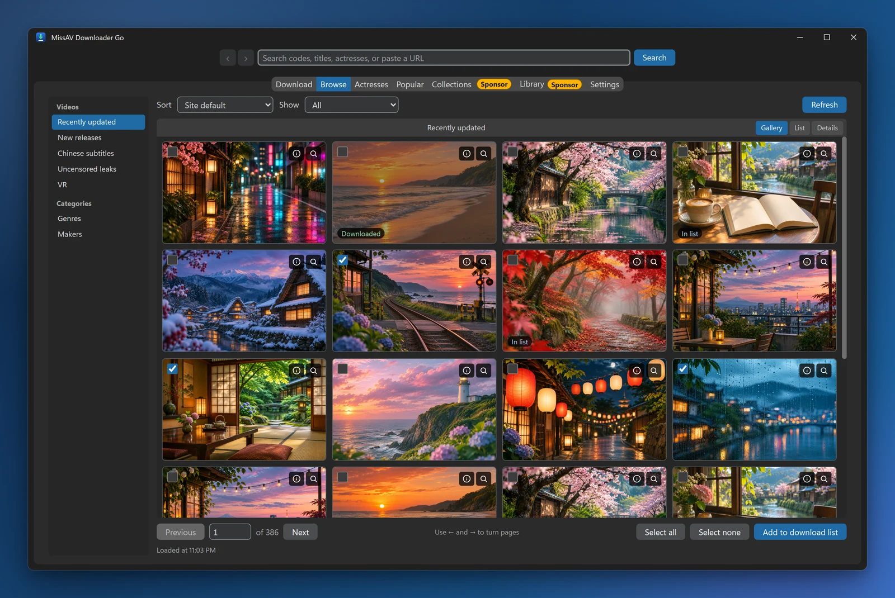
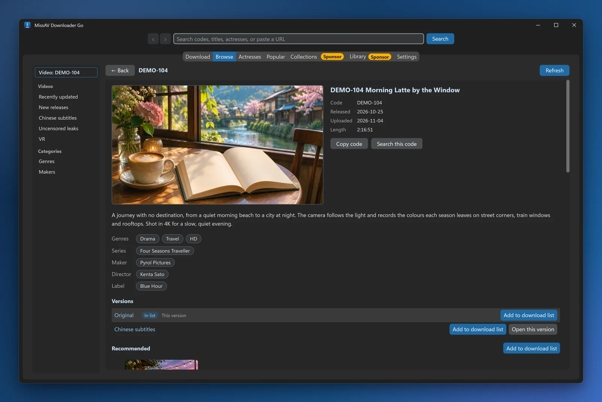
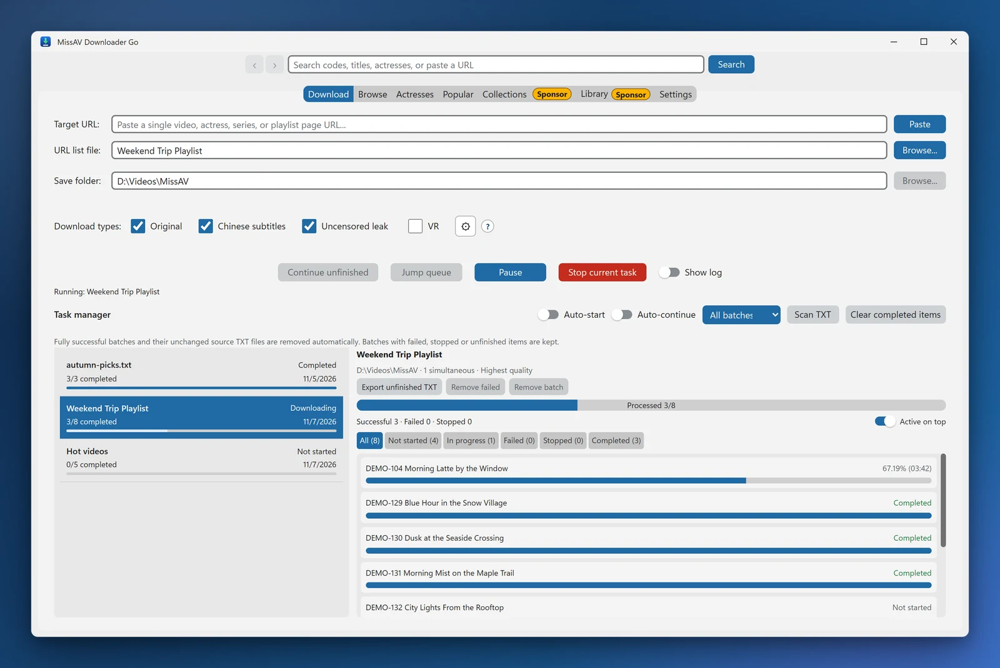

English | [繁體中文](README.md)

# MissAV Downloader Go

**MissAV Downloader Go** is an academic research tool built to study multimedia streaming, HLS (HTTP Live Streaming), and automated crawling. It explores how modern video platforms hide m3u8 resources behind dynamically obfuscated JavaScript, and how stream segments can be downloaded reliably under high concurrency.

> **What's new in v2.8.0: Browse and Actresses tabs and an in-app video page, a task manager that can auto-continue and jump the queue, broken segments from the site get cut out, and future versions can update from inside the app.** Coming from an older version? See [Upgrading from an older version](#upgrading-from-an-older-version).

### [⬇️ Download the latest release](../../releases/latest)

Portable Windows build — extract and run. Verify it against the [SHA-256 checksum](#file-verification) after downloading.

  

  
  

Codes, titles and covers in the screenshots are placeholder demo data.

---

## ✨ Core Research Features

* **🖥️ Native desktop UI** — built with Go + [Wails](https://wails.io/), rendered through the system's built-in WebView2. Light/dark themes, optionally following the system setting. The interface is available in **English and Traditional Chinese**; it follows the system language by default and can be switched in Settings at any time, no restart needed. Opening the app a second time brings back the window that's already open, so two copies never edit the same data.
* **🕷️ Smart crawling and filtering**
    * Paste an actress, series or **playlist** URL and every paginated video is collected into a URL list file. Playlists download in their original order, and the list file is named after the playlist.
    * **Work category** — when crawling an actress page, choose all, solo or multi-actress works.
    * **Variant selection** — tick the variants to download (original / Chinese subtitles / uncensored leak), with VR opt-in. The Community Edition downloads **every variant you tick**: if a code exists as both the original and a Chinese-subtitle release, both are downloaded, with `[中文字幕]` / `[無碼流出]` appended to the filename so they never overwrite each other. If you only want the original, tick only "Original".
    * Duplicate URLs for the same video are removed automatically.
* **🔥 Popular** — browse today's, this week's and this month's rankings (up to page 100), enlarge covers, and add the videos you tick straight to the download list. Which ranking opens first can be set in Settings.
* **🧭 Browsing and video pages**
    * **Browse** tab — search, the site's sections, and the genre and maker indexes, with sorting, filters and paging; tick videos to add them to the download list.
    * **Actresses** tab — the actress index, the actress ranking and each actress's works. Popular and works lists show release dates.
    * The address bar at the top takes a search, a video code or a pasted URL; back/forward work with the mouse side buttons and Alt+← / →.
    * **Video page** — see a video's details, switch to the other variants of the same code, and see recommended videos without leaving the app; right-click a video in any list for a shortcut menu.
    * Covers are cached locally, so lists scroll and go back faster.
* **🛡️ Stream probing** — a separate networking component mimics browser TLS/HTTP2 fingerprints, for studying resource discovery under modern anti-bot measures.
* **📋 Task manager**
    * An imported TXT becomes a **batch**, and each video's progress is stored locally, so it's still there after you close and reopen the app (by default nothing starts downloading on its own).
    * Failed or stopped videos can be retried individually; unfinished URLs can be exported, and completed records cleared.
    * TXT lists in the download folder are picked up automatically at startup; re-crawling the same list merges it back into its existing batch, so videos already downloaded aren't fetched again.
    * **Pause / resume / stop**, **segment-level resume** (downloaded `.ts` segments are kept, so an interruption doesn't mean starting over), **two-level progress** with an ETA, and the list scrolls itself to the video currently downloading.
    * **Auto-start** (videos imported while idle start downloading right away) and **Auto-continue** (the next batch starts as soon as a download slot frees up, without waiting for the previous batch to finish merging) — both off by default. **Jump queue** moves a batch to the front.
    * You can paste URLs into the download list while downloading. Batches that finish successfully are cleared automatically; failed, stopped and unfinished videos stay for retrying.
* **🛠️ Automation**
    * **Seamless merging** — FFmpeg (bundled, portable) losslessly merges the segments into `.mp4` when a download completes. Segments are streamed to FFmpeg in order, so there are no gaps at the joins and the duration matches the source stream.
    * **Automatic retries** — brief connection drops are retried automatically, failed segments are fetched again at the end, and a video only fails after two straight minutes without receiving any data.
    * **Broken segments cut out** — some segments on the site are broken at the source (a few KB, undecodable). They're fetched once more, and if still broken they're cut out after merging, so the video moves straight on to the next part instead of stopping on a frame that can't be decoded.
    * **Full filenames** — files are named with the full title shown on the video page, shortened automatically when too long. The final filename is only written once merging succeeds, so stopping midway never leaves a broken file behind.
    * **Download while merging** — the next video starts downloading while the previous one is still being merged.
    * **Temp cleanup** — each video's temporary segments are deleted as soon as it finishes merging; unfinished segments are kept for resuming and can be cleared from Settings with one click.
* **🧹 Clear traces** — under **Settings → Privacy** you can choose to clear the address bar's search history and the last pages you were on, the cover cache, finished download records, and the built-in browser's cache (cleared the next time the app starts).

---

## 🔑 Sponsor Edition Features

Everything listed above works fully in the Community Edition. The Sponsor Edition is, as the name suggests, for **sponsors**; it adds everything listed below.

None of that code ships inside the Community Edition's executable — these features aren't switched off, they simply aren't built in. The Community Edition has no collection monitor or scheduled video checks. Builds supporting app updates have a separate, optional startup check against GitHub; it does not continuously poll.

| Feature | Description |
| --- | --- |
| **Account sign-in** | Sign in to a missav.ai account (including shared sign-in via a browser cookie) to access the actresses you've saved on the site. |
| **Collections** | Sync the saved actress list from the site, work out which videos haven't been downloaded yet, and browse each actress's full video list; when a new video comes in several variants, one is picked automatically. The saved videos and playlists from your site account are listed too, ready to check and add to the download list. The Community Edition's Collections tab opens, but the list is always empty. |
| **Library** | Point it at video folders on a local disk, external drive or NAS, compare them with each actress's works and list what's missing; browse video files by folder; move finished downloads into the actress's folder in the library; a health check finds files with missing segments or no audio and repairs them or re-downloads and replaces them. The Community Edition's Library tab opens, but only shows an explanation. |
| **Home, subscriptions and notification center** | The Home tab gathers new videos from subscribed genres, makers, series, tags or searches, alerts you when a video you've downloaded gets a Chinese-subtitle or uncensored-leak release, and tracks the debuts of buzzworthy newcomers; all of it lands in the notification center. The Community Edition has no Home tab and checks none of this in the background. |
| **Personal data** | Local favorites, watch later, your own lists, watched marks, tags, a blocklist, browsing history and incognito mode; once signed in, favorites and lists can sync with your site account. |
| **Privacy** | A PIN required when the app opens (with an instant lock button), and thumbnail blur. Clearing traces is available in both editions. |
| **New-release monitoring** | Check saved actresses for new videos in the background on a configurable interval, with a full deep-scan pass to catch anything missed; videos newly added to tracked playlists are reported too. The Community Edition has **no collection monitor**, scheduled video checks or automatic new-video notifications. The optional GitHub app-update check is a separate feature. |
| **Local video database** | Build a local video index per saved actress, used as the baseline for new-release comparison. **Crawling itself is fully available in the Community Edition** — it still pages through the site and still writes the URL list. Only the step that files a crawled list into the database is sponsor-only. |
| **Tray icon and notifications** | Tray icon with an unread badge, Windows toast notifications, download-complete notifications, and minimize-to-tray on window close. The Community Edition has none of this: no icon in the notification area, no system notifications of any kind, and closing the window really does quit. Track downloads from the task progress in the app instead. |
| **Automatic filing** | Finished downloads are sorted into per-actress folders (solo work under the actress's name, two or more under "multiple actresses", none detected under "unclassified"), and a playlist download goes into a folder named after the playlist. The Community Edition puts everything flat in the output folder — no "multiple actresses" or "unclassified" folders are ever created. **The videos themselves, their filenames and their quality are identical**; you just end up with one flat pile that you have to organize yourself. |
| **List import rules** | When a code exists in several variants, download only one of them, in a version priority you choose (for example uncensored leak first, then Chinese subtitles). The Community Edition always downloads **every variant you tick** — tick fewer to download fewer. |
| **Clip preview** | Preview a short clip right inside the Popular and Collections lists (starting from any minute you choose), play a preview by hovering over a cover, and open the original page in one click. These two buttons don't appear in the Community Edition's lists; enlarging covers works in both editions. |
| **Video file renaming** | Drag video files onto the window and they're renamed to their full titles, following the app's own naming rules. In the Community Edition, dragging only accepts `.txt` list files. |
| **⚡ Multiple downloads at once** | The Sponsor Edition downloads up to 5 videos concurrently (3 by default); the Community Edition works through the queue **one video at a time**. **A single video downloads at exactly the same speed in both editions** — what's limited is how many run at once, not how fast each one goes. |
| **🎞️ Video quality selection** | Choose the download quality up front: highest (default), up to 1080p, up to 720p, up to 480p, or lowest — useful when disk space or bandwidth is tight. **The Community Edition always downloads at the highest quality**: for the same video, both editions pull the same stream, the same bitrate and the same file size. Nothing is downgraded — what the Sponsor Edition adds is the ability to deliberately dial it *down*. |

### What the Community Edition's UI looks like

These features are **deliberately left visible** in the Community Edition, so you can see what they are and what sponsorship would add. In practice:

* **Tabs** — Collections and Library open, with an explanation inside; the Home tab doesn't appear in the Community Edition.
* **Buttons** (sign in, refresh favorites, build database, test notification…) show a short note when clicked, telling you it's a Sponsor Edition feature and how to get in touch — no error, no dead click.
* **Toggles** (monitoring, the various notifications, "start downloading immediately after adding"…) can be switched on, but **they revert to off when settings are saved**. That's intentional: a switch stuck in the "on but doing nothing" state looks like a bug, so it honestly falls back to off.
* **Dropdowns** (concurrent site connections, concurrent downloads, video quality, close-window behavior) only list the option that applies to the Community Edition: the first two are fixed at 1, quality is fixed at the highest, and closing the window quits.
* **List import rules** are fixed to "download all selected types", and the version priority can't be changed.
* **Check interval** can be changed and will be saved, but it only feeds favorites monitoring and database building — ordinary downloading and crawling don't go through it.

The Community Edition also **ships with the right defaults already set**: monitoring and notifications start off, concurrent downloads starts at 1. There's nothing you need to turn off yourself.

### How to get the Sponsor Edition

The Community Edition is **free**, and it keeps getting updated alongside the Sponsor Edition — same source, same version number, same download engine. None of the locked features get in the way of downloading videos normally.

The Sponsor Edition is available through **sponsorship**. Keeping this project working (especially the anti-bot countermeasures after each site change) takes ongoing time, and sponsorship is what makes that sustainable.

**Email** [pyrolloryp@proton.me](mailto:pyrolloryp@proton.me) saying you'd like the Sponsor Edition, and you'll get a reply with sponsorship details and how to receive it. Technical discussion, feature suggestions and bug reports are equally welcome by email or via Issues.

The same explanation and contact address also appear at the top of the app's Settings tab.

---

## 📋 Requirements

* **Windows 10 / 11**
* **WebView2 Runtime** — already included in Windows 11 and in Windows 10 updates from 2020 onward, so you usually don't need to install anything. If the window comes up blank, install the [Microsoft Edge WebView2 Runtime](https://developer.microsoft.com/en-us/microsoft-edge/webview2/) from Microsoft.
* **FFmpeg** — a portable build is bundled. You do **not** need to download it or add it to PATH.

No Python, and no packages to install.

---

## 📦 Distribution Format

The Community Edition is currently **released for Windows only**.

Releases ship as a **folder**, not a single exe. Everything is already unpacked at build time, so the program doesn't have to extract itself into a temp directory on every launch — which is what causes the system-wide multi-core CPU spike and stutter you get from single-file bundles.

* **Keep and move the whole folder**, not just the `.exe` — on its own it can't find its dependencies and won't start.
* Some antivirus software (Microsoft Defender included) scans new executables and large sets of files in real time, which can cause a brief stall on first launch. If you trust the source, add the program folder to your antivirus exclusion list (Windows Security → Virus & threat protection → Manage settings → Exclusions).

### Upgrading from an older version

v2.5.0 and earlier have no in-app updates, so upgrade to the new version by hand once as described below; after that, new versions can be installed from inside the app (see [In-app updates](#in-app-updates)). The v2.0.0 executable was called `MissAV_Downloader.exe`; from v2.5.0 it's `MissAVDownloaderGo.exe`.

1. Extract the new version into a **new folder**.
2. Move `data` (settings) and `downloads` (URL list files and videos) over from the old folder. If you have half-finished downloads, move `temp` as well and they'll resume.
3. Open the new version, check that your settings and lists are there, then delete the old folder.

Videos you downloaded with the old version won't be downloaded again: the new version names files with the full title, but recognizes both the old and the new filenames when checking what's already downloaded. TXT lists in `downloads` are imported into the task manager at startup; nothing starts downloading on its own.

### In-app updates

Supported **Windows x64 Community Edition** packages provide this workflow under **Settings → App updates**:

1. Startup update checks are on by default and can be disabled. You can also choose **Check for updates**. Only this project's stable GitHub Releases are queried; no GitHub account is needed.
2. Read the release notes, then confirm **Download update**. Downloads show progress, can be cancelled, and verify the ZIP's SHA-256, version, platform and package format without interrupting current work.
3. Once video downloads, conversion, crawling/imports and other file operations finish, choose **Install and restart**. Neither a completed download nor becoming idle installs anything automatically. A paused video download still counts as active.
4. The bundled `MissAVUpdater.exe` waits for the main app to exit normally, replaces the app and bundled networking components/tools, then restarts it. `data`, `downloads`, `temp`, custom files and other editions' executables are left untouched.

**Older builds without an updater, including v2.5.0, need one manual upgrade to a complete updater-enabled package first.** Move your data as described above. Do not replace just the main `.exe`: the new package also includes the updater and `update-manifest.json`. Sponsor Edition and macOS builds do not use this Community Edition update source.

Network errors, GitHub rate limits, checksum failures, incompatible packages and insufficient permissions/space are reported explicitly, not as "up to date". The updater does not request administrator privileges. Failed file replacement attempts restore the old app; if it still cannot start, preserve `.update` and its backups for troubleshooting, and do not remove them while any app/update process is running. For manual recovery, close the app, extract a complete official ZIP into a new folder, then move `data`, `downloads` and `temp`; do not mix old and new networking components.

SHA-256 verifies integrity; **it is not a publisher signature**. Updates trust this project's GitHub publishing account and HTTPS. Older releases without the required updater/manifest must be downloaded manually and will not be installed automatically.

---

## 🚀 Getting Started

### Step 1: Collect the video list
* Paste a MissAV **single video**, **actress / series page** or **playlist** URL into the **Target URL** field (the "Paste" button works too).
* For an actress, series or playlist page, the program pages through the site automatically, writes every video into the URL list file, and creates a batch in the task manager.
* You can also drag a prepared `.txt` list onto the window to import it, or tick videos in the **Browse**, **Actresses** or **Popular** tab and click **Add to download list**.

### Step 2: Check the download settings
* Confirm the **URL list file** and **Save folder** paths.
* Tick the variants you want (original / Chinese subtitles / uncensored leak / VR); when crawling an actress page you can also pick a **work category** (all / solo / multi-actress).

### Step 3: Start the batch download
* Pick the batch in the **Task manager**, click **Start batch download**, and watch progress and ETA on the two progress bars.
* You can pause or stop at any time; unfinished videos stay in the batch, so selecting the same batch next time resumes them, and failed videos can be retried individually.

---

## 🔒 Verification and Disclaimer

### File verification
Compare the downloaded ZIP against the **SHA-256 checksum** published on the [Release page](../../releases/latest) to verify file integrity. A checksum is not a publisher signature.

### Legal notice
* **Academic use** — this project is for personal technical study and HLS protocol research only.
* **Respect copyright** — downloaded content remains the property of its original creators or distributors.
* **Do not use this tool for commercial gain or any infringing purpose.**
* **Liability** — any legal consequences arising from use of this tool rest with the user; the author accepts no liability.

---

## 📄 License
Released under the **MIT License**.
Copyright (c) 2026 **Pyrol**.

---

## ⭐ Support This Project

If this project helped your technical study or research, a **Star ⭐** (top right of the page) is much appreciated. Every star keeps the project maintained and helps other people find it.

---

## 📩 Contact and Support
* **Technical discussion / sponsorship**: [pyrolloryp@proton.me](mailto:pyrolloryp@proton.me)
* **Bug reports**: please open a GitHub Issue.
